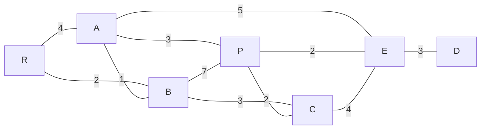

# Grafo ponderado

No dirigido; pesos en metros. Origen R, destino D. Sin bloqueos en el caso base.

Ruta mínima R → B → A → E → D, costo 11 m. También R → B → A → P → E → D cuesta 11 m. Si E se bloquea, D queda aislado.
